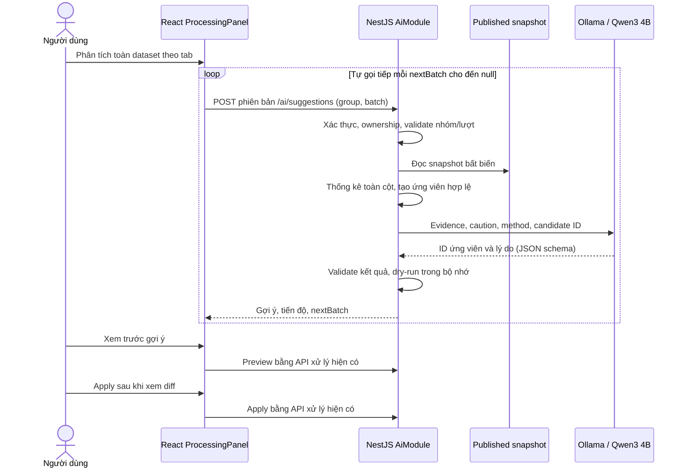

# Gợi ý xử lý bằng AI local — 18/11/2026

## Phạm vi và quyết định nghiệp vụ

Qwen3 4B gợi ý phương pháp cho toàn bộ cột của dataset **online đã đăng nhập**, theo tab hiện tại và độc lập form xử lý thủ công. Người dùng bấm Phân tích toàn bộ dataset mà không cần chọn cột/phương pháp, đọc lý do/bằng chứng/cân nhắc, chọn **Xem trước gợi ý**, rồi quyết định **Apply**. Gợi ý và Preview không công bố phiên bản mới. Người dùng có thể bỏ qua và xử lý thủ công. Không có gợi ý không có nghĩa dataset đã sạch.

Hỗ trợ sáu tab Cleaning, Missing, Outliers, Scaling, Transformation, Encoding. Collection và History không gọi AI. Đổi tab/version làm mất hiệu lực kết quả đang xem; đổi cột hoặc phương pháp thủ công không làm mất gợi ý; Apply/restore dùng cơ chế base version và ownership hiện có. Dataset local trong IndexedDB chưa gọi AI; UI thông báo giới hạn này, không tải snapshot local lên server để lấy gợi ý.

## Kiến trúc



Backend lấy thống kê chính xác trên toàn bộ dòng và tất cả cột của phiên bản, không lấy trang/filter hiện tại làm toàn dataset. Dòng trùng được xét trên tất cả cột. Mỗi lượt mô hình chỉ xếp/chọn tối đa năm ứng viên và giải thích; không được sinh method, scope hoặc parameters mới. Các specification do code tạo, có `statisticsScope: whole-columns`, được dry-run bằng `processSnapshot` và loại nếu invalid/no-op.

Chỉ evidence thống kê, caution, method và ID ứng viên được gửi tới Ollama; không gửi tên cột, columnId hoặc nội dung ô. Văn bản lý do vẫn là kết quả sinh bởi AI, có thể sai; evidence do code tính là phần đối chiếu. Không có tự động chạy mã AI, tự Apply, cloud fallback hoặc huấn luyện mô hình.

Không còn giới hạn chọn 20 cột hoặc cắt ở 12 ứng viên đầu. API nhận `{group,batch?}`; batch mặc định 0. Mỗi lượt đưa tối đa 12 ứng viên vào Qwen, response có columnCount, candidateCount, reviewedCandidateCount, totalBatches, batch và nextBatch. UI tự gọi tiếp đến nextBatch=null, gộp gợi ý với ID ổn định và cho xem thêm sau mỗi 10 thẻ. Mọi cột và ứng viên đều được xét qua các lượt; AI có thể không chọn một ứng viên, nên không đảm bảo có gợi ý cho mọi cột. Nếu lỗi/dừng giữa chừng phải ghi rõ chưa hoàn tất, không khẳng định đã sạch. Dừng/đổi tab/version hủy request và truyền tín hiệu hủy tới Ollama; xử lý thủ công vẫn sử dụng được. Giới hạn một lần inference đồng thời mỗi process backend, timeout mặc định 120 giây cho mỗi lượt (tổng thời gian phụ thuộc số lượt), ngữ cảnh 4096 token, tối đa 768 token đầu ra, `think: false`, temperature 0. Không cam kết SLA cho mọi dataset/hardware hoặc việc AI trả hết ứng viên hợp lệ.

## Danh mục ứng viên phiên bản đầu

| Nhóm | Điều kiện và phương pháp được xét |
| --- | --- |
| Cleaning | Cột text có dấu hiệu HTML → strip_html; whitespace dư → normalize_whitespace; text toàn số an toàn, không có số 0 đầu → convert_number; mixed → convert_text; dòng trùng toàn dataset → remove_duplicates |
| Missing | Cột số có missing và có dữ liệu không thiếu → fill_median/fill_mean; cột khác có missing và giá trị không thiếu → fill_mode |
| Outliers | Cột number có giá trị ngoài Tukey 1,5 IQR → clip_iqr |
| Scaling | Cột number không hằng → scale_minmax/standardize, phụ thuộc tác vụ |
| Transformation | Number không âm và không hằng → log1p; text nhiều từ → tfidf giữ cột nguồn |
| Encoding | Cột không phải number có 2–20 giá trị khác nhau và có giá trị lặp → one_hot giữ cột nguồn |

Ứng viên không khẳng định là phương pháp tốt nhất. Không tự suy ra thứ tự ordinal, định dạng ngày, giá trị điền hằng hay ý nghĩa mã định danh khi chưa có bằng chứng. Thiếu mục tiêu nghiệp vụ được nêu trong caution. Chọn thủ công vẫn hỗ trợ các method khác của ứng dụng.

## Lưu trữ và ERD

Không thêm collection, field, index, migration hoặc quan hệ. Gợi ý chỉ tồn tại trong response/state UI, không ghi History hay outbox. Khi người dùng Apply, History ghi specification thực tế bằng luồng cũ; không lưu lý do AI hoặc nhãn nguồn AI. **ERD không thay đổi vì tính năng này.**

## Thiết lập Windows

Hướng dẫn dưới đây áp dụng cho từng máy Windows. Clone repository chưa kèm runtime/model. Cách dùng chung server và các hạng mục Docker **chưa triển khai** được tách tại [sử dụng trong team và kế hoạch Docker](local-ai-deployment.md).

Yêu cầu Node theo README, PowerShell, Internet khi tải và đủ ổ đĩa cho runtime/model. Các script dùng bản portable chính thức Ollama `v0.40.16`, kiểm SHA-256 từ GitHub release khi tải runtime; model do Ollama tải và kiểm digest. Bản Qwen3 4B dùng Q4_K_M, khoảng 2,5 GB; dung lượng này không phải RAM/VRAM khi chạy.

```powershell
npm run ai:setup   # tải runtime/model, chạy server loopback ẩn
npm run dev:ai     # khởi động lại AI nếu cần rồi chạy ứng dụng
npm run ai:check   # build backend, smoke test service với mô hình thật, dữ liệu tổng hợp
```

`npm run dev` vẫn dùng được khi Ollama đã chạy. `npm run ai:start` chỉ khởi động server nếu chưa có API tại 127.0.0.1:11434; không tạo Windows startup task và không tự tải khi chạy dev. Ollama sống độc lập sau khi dừng dev; dừng PID Ollama đã khởi động nếu muốn giải phóng dịch vụ/bộ nhớ. Model được giữ trong bộ nhớ tối đa 5 phút sau inference; `keep_alive` do request cấu hình.

Runtime, model và log nằm ở `.artifact-work/ollama/`, đã được gitignore. Không commit binary/model. Nếu dùng một server Ollama đang chạy sẵn, script không thay cấu hình server đó; kiểm tra có model `qwen3:4b` bằng `ai:check`. Đường dẫn model của bản portable được chỉ định bằng `OLLAMA_MODELS`. Cloud bị tắt khi script khởi động portable (`OLLAMA_NO_CLOUD=1`). Không cần API key trả phí.

Biến môi trường backend (có mặc định hoạt động, xem `backend/.env.example`):

```dotenv
AI_ENABLED=true
AI_OLLAMA_URL=http://127.0.0.1:11434
AI_MODEL=qwen3:4b
AI_TIMEOUT_MS=120000
```

URL chỉ chấp nhận origin HTTP loopback, không path/query/credentials; timeout 1000–180000 ms. Model tích hợp hiện cố định `qwen3:4b`. Khi deploy, local là **máy chạy backend**, không phải trình duyệt người dùng; phải bố trí Ollama cùng máy/môi trường mạng loopback phù hợp. Backend không nhận URL/model từ request người dùng. Không mở cổng Ollama ra Internet.

Backend và Ollama ở hai container riêng chưa dùng được chỉ bằng thay `.env`: `http://ollama:11434` hiện bị validator từ chối. Cần bổ sung đóng gói, cho phép địa chỉ nội bộ có kiểm soát, volume model, khởi tạo/readiness và nghiệm thu theo [kế hoạch Docker](local-ai-deployment.md#kế-hoạch-docker-compose--chưa-triển-khai). Một inference/process hiện chưa phải hàng đợi cho server nhiều người dùng.

Nguồn: [Ollama Windows](https://docs.ollama.com/windows), [Qwen3 4B trên Ollama](https://ollama.com/library/qwen3:4b), [Qwen3 4B / Apache 2.0](https://huggingface.co/Qwen/Qwen3-4B), [Structured outputs](https://docs.ollama.com/capabilities/structured-outputs).

## Nghiệm thu

- Unit backend: DTO nhóm/lượt không nhận cột/phương pháp, thống kê toàn dataset, hơn 20 cột và 12 ứng viên có gợi ý cột cuối, bảo toàn mã text, duplicate toàn dòng, ownership trước đọc, snapshot bất biến, empty, output sai/ID giả/trùng, timeout/busy/disabled/unavailable, URL local.
- Unit frontend: gợi ý sai tab/cột/parameters bị chặn, version binding và transport có xác thực.
- Browser fixture: chỉ lấy gợi ý không Preview/Apply; Preview không đổi nguồn; Apply tường minh mới đổi; giữ gợi ý khi đổi cột/phương pháp thủ công, bỏ response cũ khi đổi tab/version, nhiều lượt và lỗi/dừng giữa chừng; error/empty/offline không khóa xử lý thủ công; mobile.
- `npm run ai:check`: service thật gọi Ollama với fixture Cleaning/Missing, kiểm snapshot không đổi và báo thời gian/GPU memory. Không cần database và không ghi dữ liệu người dùng.
- Kiểm định chất lượng trên dữ liệu nghiệp vụ thực tế, dataset lớn, nhiều người dùng và đánh giá dài hạn không được suy ra từ fixture.
