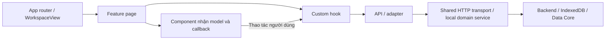

# Chuẩn hóa cấu trúc frontend — 18/11/2026

## Mục tiêu và kết quả tổ chức

Frontend giữ bảy feature `auth/projects/datasets/analysis/processing/history/offline`. Mỗi feature có code thật trong `api`, `hooks`, `components`, `pages`, thay cho các thư mục chỉ có `export {}` và README chuẩn bị. Không tạo thêm URL cho các page nhúng trong workspace.

Kiểm kê cuối: **28 thư mục bắt buộc, 65 file triển khai** (không tính `index.ts`); mọi README của các thư mục này liên kết tới file hiện có.

| Thư mục | Trách nhiệm | Ví dụ thực tế |
| --- | --- | --- |
| `api` | HTTP, hợp đồng request/response và adapter online/local | `processing/api/online-processing.ts`, `history/api/history-api.ts`, `offline/api/project-api.ts` |
| `hooks` | State/effect, validation, tải dữ liệu, tác vụ nghiệp vụ và cleanup/retry | `useProcessing`, `useAiSuggestions`, `useHistory`, `useOfflineWorkspace` |
| `components` | Hiển thị model, form, biểu đồ và callback tương tác | `ProcessingPanel`, `ProjectsView`, `ImportWizard`, `HistoryPanel` |
| `pages` | Ghép hook với giao diện thành màn hình/khối màn hình | `ProcessingPage`, `AnalysisPage`, `HistoryPage`, `DatasetImportPage`, `AuthPage`, `ProjectsPage`, `OfflineWorkspace` |

State trình bày như camera/hover/focus vẫn thuộc renderer. Component con có thể dùng custom hook của feature để gắn lifecycle; việc gọi API, lưu dữ liệu và quản lý thao tác không nằm trực tiếp trong JSX. Các helper miền thuần, types, IndexedDB store và replay service có thể nằm ở root feature.

## Các luồng sau khi tách

- **Processing:** `pages/ProcessingPage.tsx` gọi `hooks/useProcessing.ts`, đưa model vào `components/ProcessingPanel.tsx`. Hook giữ method/scope/form, Preview–Apply, expiry, khóa điều hướng và khóa idempotency. `api/online-processing.ts` tạo adapter online; `api/processing-api.ts` gửi request. Gợi ý AI được quản lý bởi `hooks/useAiSuggestions.ts`.
- **Analysis:** `AnalysisPage` ghép `useAnalysis` với `AnalysisPanel`. Summary/distribution/correlation/points/boxplot có hook riêng và dùng `useResource` để tải/hủy/retry. `usePointRowEditor` giữ trạng thái sửa ô và recovery Preview–Apply; bảng chỉ hiển thị và gọi callback.
- **History:** `HistoryPage` → `useHistory` → `historyApi`; `HistoryPanel` hiển thị lịch sử/dialog. Khóa restore được giữ khi chưa xác định kết quả; restore vẫn tạo version mới.
- **Datasets:** `DatasetImportPage` → `useImportWizard` → `datasetsApi` hoặc callback local; `ImportWizard` hiển thị form/schema/preview. `useDataTable` giữ filter typed; bảng vẫn nhận state/data từ workspace.
- **Auth/Projects:** page gọi `useAuthForm`, `useProfile`, `useProjects`; giao diện được tách thành `AuthView`, `ProfileView`, `ProjectsView`. `useAccountActions` quản lý kiểm dữ liệu local, xác nhận xóa/đăng xuất và account lock.
- **Offline:** `OfflineWorkspace` ghép `useOfflineWorkspace` và `OfflineWorkspaceView`; hook riêng xử lý workspace, sync state và backup/recovery. `useSyncCoordinator` giữ lifecycle auto-sync. `api/project-api.ts` giữ HTTP sync có owner binding; `api/local-processing.ts` giữ adapter local.
- **Workspace online:** điều phối nhiều feature vẫn ở `app/hooks/useWorkspace.ts`; `app/pages/WorkspacePage.tsx` ghép hook với `app/components/WorkspaceView.tsx`. Không đưa điều phối chéo vào một feature để tránh vòng phụ thuộc.

## Tương thích và kiểm soát cấu trúc

Public index vẫn giữ tên cũ `ProcessingPanel`, `AnalysisPanel`, `HistoryPanel`, `ImportWizard` như alias tới page container để không phá consumer hiện hữu. App/workspace mới sử dụng tên page rõ ràng. Component nội bộ cùng tên nhận model từ hook, không phải entry point để feature khác import sâu.

Các đường dẫn offline `processing-adapter.ts` và `sync-coordinator.tsx` giữ re-export tương thích cho consumer/test cũ; code thực đã chuyển vào `api`, `hooks`, `components`. `project-sync.ts` giữ orchestration/replay miền và re-export `ProjectApi`; HTTP implementation nằm trong `api/project-api.ts`.

`check-architecture.mjs` kiểm chiều import và vòng phụ thuộc, đồng thời xác minh bốn thư mục bắt buộc có implementation, ngăn import `requestJson` trực tiếp vào feature page/component và ngăn page tự giữ state/effect nghiệp vụ. Các kiểm tra này bổ trợ review, không thay thế kiểm ngữ nghĩa của mọi callback hoặc mọi kiểu truy cập mạng.

## Kiểm chứng

| Kiểm tra | Kết quả |
| --- | --- |
| Frontend unit | 34/34 đạt |
| Offline replay | 10/10 đạt |
| Typecheck và architecture | Đạt; 151 file, không vòng phụ thuộc |
| Frontend lint | Đạt trên source cuối |
| Build backend/frontend | Đạt; cảnh báo chunk WebGL lớn hiện hữu vẫn được công khai |
| Browser AI fixture | 11/11 đạt; batch/cancel/stale/manual fallback/mobile |
| Acceptance HTTPS/Nest/MongoDB replica tạm | 53/53 đạt trong một lượt đầy đủ, khoảng 7,9 phút |

Typecheck gồm source và test; architecture check đạt với 151 file. Build cuối sau dọn kiểu/import giữ nguyên các bundle `index-gzM7feyH.js`, `WebGLScatter-C9Oh6e6Z.js` và stylesheet so với bản đã chạy acceptance. Các ca dài gồm đủ 27 phương pháp online, 27 phương pháp offline→server parity, sửa ô, receipt loss, expiry/no-op, restore, account lifecycle, autosave/CAS/draft, quota, backup/recovery, auto-sync nhiều tab và giao diện hẹp.

Acceptance dùng tài khoản, CSV và database tạm riêng; browser AI fixture kiểm UI với adapter fixture, không thay thế đánh giá mô hình thật. Không dùng dữ liệu Atlas của người dùng. Artifact/trace/screenshot nằm trong `frontend/test-results`, không đưa vào commit. Không chạy lại k6 vì thay đổi này tổ chức frontend, không tối ưu backend hoặc thay mục tiêu hiệu năng.
