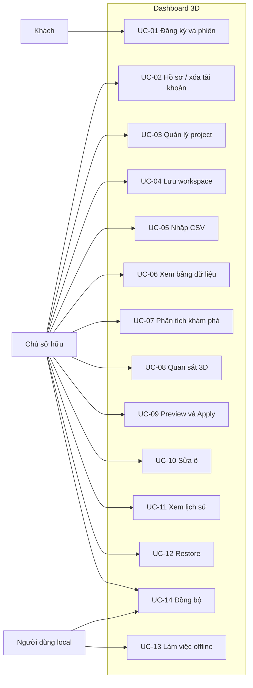

# Đặc tả use case — Dashboard 3D

Ngày lập: **18/11/2026**. Phạm vi và thuật ngữ theo [SRS](../requirements/software-requirements-specification.md); ID yêu cầu theo [FR](../requirements/functional-requirements.md). ERD trong cùng thư mục là mô hình dữ liệu, không thay thế đặc tả use case này.

## 1. Tác nhân và sơ đồ tổng quan

- **Khách:** chưa có phiên online, có thể đăng ký/đăng nhập.
- **Chủ sở hữu:** người dùng đã xác thực, chỉ thao tác tài nguyên của mình.
- **Người dùng local:** thao tác dữ liệu trên thiết bị, có thể chưa xác thực online. Đồng bộ yêu cầu chuyển sang trạng thái xác thực đúng tài khoản.

Database, engine, IndexedDB và service worker là thành phần triển khai trong ranh giới hệ thống, không phải vai trò người dùng. Sơ đồ Mermaid dưới đây biểu diễn các mục tiêu theo tác nhân, không phải UML use-case chuẩn.

## 2. Quy ước chung

Các UC online ngoài đăng ký/đăng nhập cần phiên hợp lệ và quyền sở hữu. Thiếu phiên xử lý 401; sai quyền 403; không có tài nguyên/quan hệ phù hợp theo API trả 404. Lỗi request 400, conflict 409, preview hết hạn 410, vượt giới hạn 413, rate limit 429; lỗi server/network hiển thị rõ. Không biến timeout thành thông báo thành công. Mutation có idempotency giữ nguyên key/payload khi retry; chưa rõ kết quả thì recovery trước. Không thay đổi snapshot published tại chỗ.

### UC-01 — Đăng ký và quản lý phiên

- **Tác nhân:** Khách/người dùng có phiên. **Liên kết:** FR-01.
- **Kích hoạt/tiền điều kiện:** mở form hoặc chọn đăng xuất; online để xác thực server.
- **Luồng chính:** (1) Nhập email/password để đăng ký nếu chưa có tài khoản. (2) Hệ thống kiểm dữ liệu, tạo user và trả kết quả. (3) Người dùng đăng nhập; server xác thực và cấp access token/cookie refresh. (4) Frontend dùng access token cho API, refresh single-flight khi cần. (5) Chọn đăng xuất; server revoke session, frontend dọn trạng thái xác thực.
- **Ngoại lệ:** email trùng 409; dữ liệu sai 400; đăng nhập/refresh không hợp lệ 401; Origin/rate limit bị từ chối; mất mạng không giả có phiên online. Logout không phụ thuộc access token còn hạn. Không tự coi register là login.
- **Hậu điều kiện:** có phiên hợp lệ sau login hoặc không còn phiên sử dụng sau logout; không lưu token vào dữ liệu local.

### UC-02 — Cập nhật hồ sơ hoặc xóa tài khoản

- **Tác nhân:** Chủ sở hữu. **Liên kết:** FR-02, FR-03.
- **Tiền điều kiện:** phiên online hợp lệ; người dùng mở hồ sơ.
- **Luồng chính:** (1) Tải hồ sơ. (2) Sửa displayName hoặc theme. (3) Gửi PATCH các trường thay đổi. (4) Hiển thị kết quả và giữ khi reload.
- **Luồng thay thế xóa:** người dùng chọn xóa, xem cảnh báo tác động/dữ liệu local chưa sync và xác nhận; hệ thống khóa tài khoản, revoke mọi phiên, cleanup dữ liệu; chỉ sau 204 UI thông báo hoàn tất và dọn xác thực.
- **Ngoại lệ:** trường sai/patch rỗng; session không còn hợp lệ; deleting hoặc cleanup lỗi thì hiển thị trạng thái thật, không báo đã xóa hoàn tất.
- **Hậu điều kiện:** hồ sơ được cập nhật hoặc tài khoản/dữ liệu server đã được xóa sau thành công; không suy ra đã xóa mọi bản local trên mọi thiết bị.

### UC-03 — Quản lý project

- **Tác nhân:** Chủ sở hữu. **Liên kết:** FR-04, FR-05.
- **Tiền điều kiện:** phiên online hợp lệ; mở dashboard project.
- **Luồng chính:** (1) Xem danh sách có phân trang/sort/lifecycle. (2) Nhập tên và tạo project với key ổn định. (3) Hệ thống tạo project empty và workspace mặc định. (4) Mở chi tiết hoặc đổi tên project.
- **Luồng thay thế xóa:** chọn project, xác nhận xóa; hệ thống khóa ghi và cleanup mọi dữ liệu phụ thuộc; trả 204 rồi UI cập nhật danh sách.
- **Ngoại lệ:** tên không hợp lệ, sai owner, mất tài nguyên hoặc key khác payload; cleanup chưa xong không báo xóa thành công. Project trùng tên được phép.
- **Hậu điều kiện:** project/workspace được tạo hoặc cập nhật; nếu xóa thành công thì không còn dữ liệu phụ thuộc của project.

### UC-04 — Lưu và mở lại workspace

- **Tác nhân:** Chủ sở hữu. **Liên kết:** FR-06.
- **Tiền điều kiện:** mở project, đã tải workspace/revision hiện tại.
- **Luồng chính:** (1) Đổi tab, trục, selection hoặc filter/sort/page. (2) Frontend gửi PATCH với revision và boundVersionId. (3) Server merge/kiểm refs và CAS. (4) UI nhận workspace cùng revision mới hoặc giữ revision nếu không đổi; hiển thị adjustments. (5) Mở lại project nhận cấu hình đã lưu.
- **Ngoại lệ:** stale 409 thì tải/reconcile có thông báo, không ghi đè mù; cột/dòng mất sau đổi version được bỏ refs phù hợp và clamp page.
- **Hậu điều kiện:** cấu hình hợp lệ đã lưu; dữ liệu snapshot không đổi chỉ vì đổi filter/trục.

### UC-05 — Nhập CSV

- **Tác nhân:** Chủ sở hữu. **Liên kết:** FR-07.
- **Tiền điều kiện:** project chưa có dataset; có file UTF-8 trong giới hạn.
- **Luồng chính:** (1) Chọn CSV/delimiter. (2) Xem suy kiểu, tùy chọn override theo vị trí cột. (3) Gửi multipart file/importOptions với idempotency key. (4) Server parse toàn file, kiểm schema/giới hạn, tạo snapshot và công bố version đầu cùng operation import. (5) UI mở bảng/summary, project chuyển ready.
- **Ngoại lệ:** sai CSV/kiểu trả vị trí record/line/column; quá dung lượng 413; project đã có dataset 409. Mất response dùng lại key/recovery, không tạo import lặp. Header-only hợp lệ; không tự tạo dataset rỗng khi parse lỗi.
- **Hậu điều kiện:** dataset/version published/history nhất quán hoặc không có phiên bản công bố dở dang.

### UC-06 — Xem bảng và chọn dòng

- **Tác nhân:** Chủ sở hữu. **Liên kết:** FR-08.
- **Tiền điều kiện:** dataset có version published truy cập được.
- **Luồng chính:** (1) Tải metadata/schema. (2) Tải trang rows. (3) Đặt filter/sort/page theo contract. (4) Chọn dòng/ô bằng ID; có thể tải riêng rowId từ điểm 3D. (5) Hiển thị typed value/missing và số lượng/trang.
- **Ngoại lệ:** query sai 400; trang vượt tổng trả danh sách rỗng; row không có 404; phiên bản staged không đọc qua API published.
- **Hậu điều kiện:** người dùng quan sát đúng version; filter không thay dữ liệu hoặc scope processing.

### UC-07 — Phân tích khám phá dữ liệu

- **Tác nhân:** Chủ sở hữu. **Liên kết:** FR-09.
- **Tiền điều kiện:** có version published.
- **Luồng chính:** (1) Mở summary. (2) Chọn cột xem histogram/frequency/value counts/boxplot và missing/outlier. (3) Mở correlation Pearson. (4) Hiển thị counts, rates, ngưỡng và lý do không tính được.
- **Ngoại lệ:** cột không số/all-missing/constant hoặc thiếu cặp hợp lệ có trạng thái/null/reason phù hợp; mẫu outlier bị cắt phải có tổng và truncated. Không tính EDA chỉ trên trang bảng.
- **Hậu điều kiện:** có kết quả phân tích gắn version; không thay snapshot.

### UC-08 — Quan sát 3D và truy về dòng

- **Tác nhân:** Chủ sở hữu. **Liên kết:** FR-10.
- **Tiền điều kiện:** có cột number cho trục X/Y/Z và version published.
- **Luồng chính:** (1) Chọn trục/colorMode và tham số outlier. (2) Hệ thống lấy tọa độ/bounds/flags/sampling. (3) Vẽ các điểm hữu hạn; hiển thị vùng cho dòng thiếu/tọa độ sai và số chưa vẽ. (4) Người dùng quay/zoom/chọn điểm. (5) Truy đúng rowId để xem hoặc bắt đầu UC-10.
- **Ngoại lệ:** trục không hợp lệ báo lỗi; WebGL không khả dụng dùng fallback; không thay tọa độ thiếu bằng 0, không ẩn thông tin sampling.
- **Hậu điều kiện:** lựa chọn liên kết đúng dữ liệu; chỉ thay cấu hình hiển thị nếu lưu workspace.

### UC-09 — Xem trước và áp dụng tiền xử lý

- **Tác nhân:** Chủ sở hữu. **Liên kết:** FR-11, FR-12.
- **Tiền điều kiện:** biết currentVersionId; đã chọn method/scope/tham số hợp lệ.
- **Luồng chính:** (1) Gửi baseVersionId/specification và key Preview. (2) Server chạy core, tạo preview/candidate ẩn. (3) Người dùng xem summary/schema diff/diagnostics và before/after. (4) Khi ready và canApply=true, chọn Apply. (5) Gửi previewId với key Apply riêng. (6) Server kiểm quyền/TTL/base và công bố nguyên tử version/head/history/receipt. (7) UI tải version mới và reconcile workspace.
- **Ngoại lệ:** request sai 400; dữ liệu không hợp lệ tạo preview invalid; no-op không cho Apply; preview hết hạn 410; stale/consumed/no-op conflict theo API. Người dùng bỏ preview thì head không đổi. Retry cùng thao tác giữ key, không chạy method lại bằng tham số mới dưới cùng key.
- **Hậu điều kiện:** Apply thành công tạo đúng một version/process operation; nếu chưa Apply thành công thì head và history xử lý không đổi.

### UC-10 — Sửa một ô

- **Tác nhân:** Chủ sở hữu. **Liên kết:** FR-13, FR-11, FR-12.
- **Tiền điều kiện:** chọn rowId/columnId từ bảng hoặc dòng của điểm 3D, có base hiện hành.
- **Luồng chính:** (1) Nhập typed value phù hợp schema. (2) Chọn lưu ô. (3) UI chạy edit_cell Preview–Apply nội bộ theo kiểm tra của UC-09, với key ổn định cho từng bước của lần lưu. (4) Hiển thị version và giá trị mới.
- **Ngoại lệ:** giá trị sai kiểu, row/column không thuộc version, no-op hoặc base stale thì báo lỗi tương ứng, không sửa trực tiếp published. Muốn đổi kiểu cả cột phải dùng convert.
- **Hậu điều kiện:** có version/history process cho thay đổi thật; token missing được bảo toàn hoặc thay đổi theo giá trị người dùng gửi.

### UC-11 — Xem lịch sử

- **Tác nhân:** Chủ sở hữu. **Liên kết:** FR-14.
- **Tiền điều kiện:** có dataset truy cập được.
- **Luồng chính:** (1) Mở History. (2) Tải operations mới nhất trước, phân trang/lọc kind. (3) Xem base/result/specification/summary. (4) Chọn version đích nếu muốn UC-12.
- **Ngoại lệ:** chưa có thao tác hiển thị danh sách rỗng; lỗi truy cập/network không được trình bày như không có history.
- **Hậu điều kiện:** quan sát được chuỗi thao tác thành công; không thay dữ liệu.

### UC-12 — Khôi phục phiên bản

- **Tác nhân:** Chủ sở hữu. **Liên kết:** FR-15.
- **Tiền điều kiện:** version đích published thuộc dataset, khác current; biết currentVersionId.
- **Luồng chính:** (1) Chọn đích và xác nhận tạo bản khôi phục. (2) Gửi restore với expectedCurrentVersionId và key. (3) Server kiểm base/owner rồi sao chép trạng thái đích thành version published mới, ghi restoredFromVersionId và operation restore. (4) UI mở version mới/reconcile workspace.
- **Ngoại lệ:** target không thuộc dataset/chưa published 404; head đổi 409; target=current trả NO_CHANGES_TO_RESTORE. Retry/recovery không tạo restore lặp.
- **Hậu điều kiện:** dữ liệu hiện tại tương ứng đích qua version mới, lịch sử cũ giữ nguyên.

### UC-13 — Tiếp tục làm việc offline

- **Tác nhân:** Người dùng local. **Liên kết:** FR-16.
- **Tiền điều kiện:** app shell đã cache, IndexedDB khả dụng; dùng local workspace với dữ liệu đã lưu hoặc file trên thiết bị. Không suy ra mọi project online tự có bản local.
- **Luồng chính:** (1) Mở trang offline. (2) Tạo/mở local project, nhập CSV nếu cần. (3) Xem bảng/EDA/3D và thực hiện processing/restore bằng core chung. (4) Ghi snapshot/history/workspace và outbox nhất quán. (5) Sau commit mới báo đã lưu local; reload đọc lại được.
- **Ngoại lệ:** lần đầu chưa cache không tải được app khi mất mạng; quota/ghi lỗi phải thông báo và không báo lưu thành công; local storage bị xóa thì dữ liệu đã lưu ở đó mất. Không chứa token trong outbox.
- **Hậu điều kiện:** trạng thái đã commit bền local, lệnh chờ sync được đánh dấu rõ, chưa đồng nghĩa có bản server.

### UC-14 — Đồng bộ dữ liệu local lên server

- **Tác nhân:** Người dùng local đồng thời xác thực đúng tài khoản online. **Liên kết:** FR-17.
- **Tiền điều kiện:** có mạng, local snapshot/outbox/file/checkpoint phù hợp; account và engine tương thích.
- **Luồng chính:** (1) Chọn đồng bộ và xác thực/khôi phục phiên. (2) Kiểm account, source hash/options và server head. (3) Tạo/map project/dataset bằng key ổn định; đối chiếu schema/typed values/position để map ID. (4) Replay processing/restore đúng phụ thuộc, map cột sinh theo lineage; xác minh candidate. (5) Lưu checkpoint sau từng bước đã xác nhận. (6) Xác minh head cuối và đánh dấu đã đồng bộ.
- **Ngoại lệ:** đổi account, source/engine không tương thích, mất quyền/tài nguyên hoặc head khác thì dừng và giữ local, báo nguyên nhân. Mất mạng/response thì giữ checkpoint/key, xác minh receipt/operation trước khi tiếp tục; preview hết hạn xử lý theo recovery, không blind Apply hay tạo key mới khi commit chưa rõ. Không tự ghi đè server hoặc chuyển queue sang tài khoản khác.
- **Hậu điều kiện:** server phản ánh chuỗi đã xác minh và mapping/checkpoint được lưu; khi dừng, bản local và tiến độ còn để xử lý/tiếp tục.

## 3. Kiểm thử use case

Mỗi UC cần ít nhất luồng thành công và ngoại lệ có tác động đến dữ liệu/quyền. UC-05/09/12/14 cần kiểm retry sau mất response; UC-04/09/12/14 cần kiểm cạnh tranh head/revision; UC-13/14 cần reload, quota, account mismatch và online/offline parity. Các điều kiện bảo mật/toàn vẹn/giới hạn xuyên suốt nằm ở [NFR](../requirements/non-functional-requirements.md). Tài liệu này không gán nhãn đạt khi chưa có kết quả kiểm thử tương ứng.

## UC-AI — Tham khảo gợi ý xử lý

**Tác nhân:** chủ sở hữu dataset online đã đăng nhập. **Tiền điều kiện:** published version và cột hợp lệ, tab xử lý Cleaning/Missing/Outliers/Scaling/Transformation/Encoding.

1. Người dùng mở tab xử lý và bấm Phân tích toàn bộ dataset, không cần chọn cột/phương pháp.
2. Hệ thống kiểm quyền, thống kê tất cả dòng/cột, tự gọi tiếp từng lượt ứng viên và yêu cầu Qwen3 4B chọn/giải thích các ứng viên đã kiểm soát.
3. Hiển thị gợi ý gộp từ mọi lượt (tối đa năm/lượt), tiến độ/chưa hoàn tất nếu lỗi hoặc dừng; mỗi gợi ý gồm phương pháp, cột/phạm vi, reason, evidence và caution.
4. Người dùng có thể bỏ qua hoặc chọn Xem trước gợi ý; hệ thống nạp specification và tạo Preview bằng luồng cũ.
5. Người dùng xem diff rồi quyết định Apply hoặc hủy. Chỉ Apply thành công mới tạo version/history.

**Ngoại lệ:** empty không khẳng định dữ liệu sạch; AI tắt/lỗi/timeout/busy cho phép thử lại và xử lý thủ công. Đổi tab/version hủy/bỏ gợi ý cũ; đổi cột/phương pháp thủ công giữ gợi ý. Dataset local chỉ hiện thông báo chưa hỗ trợ AI. **Hậu điều kiện:** lấy gợi ý không ghi dữ liệu; Preview/Apply giữ hợp đồng hiện có. [Chi tiết](../architecture/local-ai.md).
